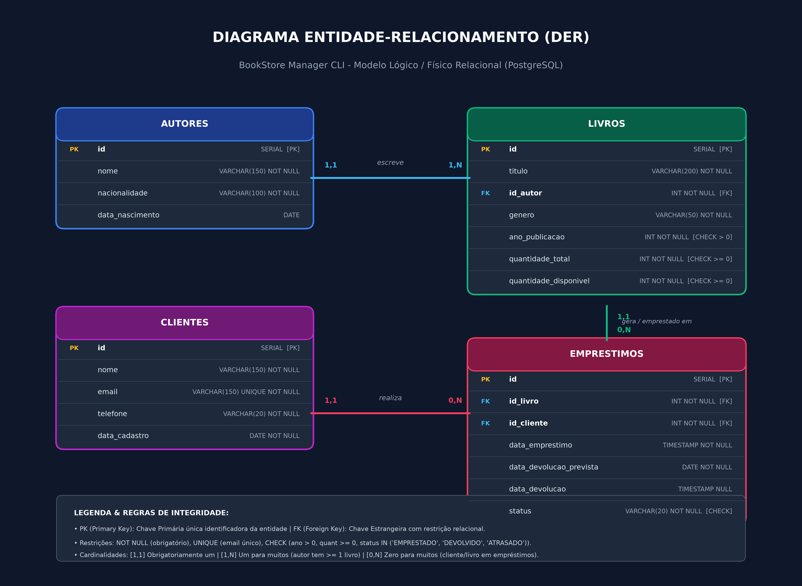

<<<<<<< Updated upstream
# BookStore-Manager-CLI
=======
# BookStore Manager CLI

Aplicação executável via terminal (CLI) desenvolvida em **Node.js** com **TypeScript** para gerenciamento de uma pequena livraria. O sistema permite administrar autores, livros, clientes e empréstimos mantendo os dados em memória durante a execução, acompanhado da modelagem relacional completa e script SQL para PostgreSQL.

---

## 1. Descrição do Projeto

O **BookStore Manager CLI** foi desenvolvido como Projeto Final Avaliativo do **Módulo 01 (Semana 13)** do curso de Desenvolvedor(a) Back End Node. Ele simula o ambiente profissional de um sistema corporativo de pequeno porte, estruturado sob arquitetura em camadas, Clean Code e tipagem estática rigorosa.

---

## 2. Objetivo

Informatizar o controle operacional de uma livraria, substituindo registros manuais por uma aplicação intuitiva no terminal, permitindo:
- Cadastro, consulta, atualização e remoção de **Autores**, **Livros** e **Clientes**.
- Controle rigoroso de **Empréstimos** e **Devoluções**, validando existência e estoque disponível.
- Projeto e implementação de banco de dados relacional independente em **PostgreSQL** para consultas e relatórios gerenciais analíticos.

---

## 3. Tecnologias Utilizadas

- **Node.js** (v18+)
- **TypeScript** (v5+)
- **PostgreSQL** (v14+)
- **Git & GitHub** para controle de versão
- **readline** (módulo nativo do Node.js para interação CLI assíncrona)

---

## 4. Requisitos para Execução

- Node.js instalado (versão 18 ou superior).
- npm instalado (geralmente empacotado com o Node).
- PostgreSQL instalado e em execução (para rodar o script SQL de relatórios).

---

## 5. Instalação

Clone o repositório e instale as dependências de desenvolvimento:

```bash
git clone https://github.com/Jovannyto/BookStore-Manager-CLI.git
cd BookStore-Manager-CLI
npm install
```

---

## 6. Execução da Aplicação

### Modo de Desenvolvimento / Execução Direta:
Conforme especificado no requisito **RNF01**, utilize:

```bash
npm run dev
```

Este comando compila o TypeScript e inicia a aplicação interativa imediatamente.

### Outros scripts disponíveis:
- `npm run build`: Compila o TypeScript para a pasta `dist/`.
- `npm start`: Executa o código já compilado em `dist/src/main.js`.
- `npm test`: Executa a verificação estática de tipos (`tsc --noEmit`).

---

## 7. Execução do Script SQL no PostgreSQL

O projeto do banco de dados relacional é independente da aplicação em memória e está localizado na pasta `database/`.

### Opção 1: Via Terminal (`psql`)
```bash
psql -U postgres -d postgres -f database/script.sql
```

### Opção 2: Via Interface Gráfica (DBeaver, pgAdmin ou VS Code)
1. Conecte-se à sua instância local do PostgreSQL.
2. Abra o arquivo `database/script.sql`.
3. Execute o script integralmente (`Ctrl + A` e depois `F5` ou botão Executar).

O script está dividido em 3 seções:
1. **DDL**: Criação das tabelas (`autores`, `livros`, `clientes`, `emprestimos`), chaves primárias, estrangeiras e constraints (`NOT NULL`, `UNIQUE`, `CHECK`).
2. **DML**: Carga inicial idêntica ao seed da aplicação, além de demonstrações de `UPDATE` e `DELETE`.
3. **DQL (Relatórios)**: Consultas relacionais com `JOIN`, `GROUP BY`, `ORDER BY` e funções de agregação.

---

## 8. Diagrama Entidade-Relacionamento (DER)

O modelo relacional do banco de dados contempla as entidades **Autores**, **Livros**, **Clientes** e **Empréstimos**, mapeando chaves primárias (PK), chaves estrangeiras (FK) e cardinalidades:



> O arquivo vetorial para impressão também está disponível em [`database/der.pdf`](database/der.pdf).

---

## 9. Arquitetura do Projeto

A aplicação adota uma **Arquitetura em Camadas** com clara separação de responsabilidades e baixo acoplamento:

```
[ Usuário ]
    │
    ▼
[ Menus ] ─────────► Exibição e captura de opções no terminal
    │
    ▼
[ Controllers ] ───► Validação de entrada, formatação e orquestração de I/O
    │
    ▼
[ Services ] ──────► Regras de negócio, consistência e validação assíncrona
    │
    ▼
[ Repositories ] ──► Acesso e persistência dos dados em memória (Arrays)
    │
    ▼
[ Dados em Memória ] (Carregados via data/seed.ts)
```

- **Models**: Interfaces (`Interfaces.ts`), Classes (`Classes.ts`) e Tipos (`Types.ts`) com tipagem estática rigorosa.
- **Utils**: Módulos utilitários compartilhados (`dateUtils.ts` e `validationUtils.ts`).

---

## 10. Estrutura de Pastas

```
BookStore-Manager-CLI/
├── controllers/          # Controladores da aplicação (recebem entradas e chamam services)
│   ├── Autorcontroller.ts
│   ├── ClienteController.ts
│   ├── EmprestimoController.ts
│   └── LivroController.ts
├── data/                 # Dados iniciais para simulação em memória
│   └── seed.ts
├── database/             # Projeto do banco de dados relacional (PostgreSQL)
│   ├── der.dbml          # Código de modelagem DBML
│   ├── der.pdf           # DER em formato PDF
│   ├── der.png           # DER em formato de imagem
│   └── script.sql        # Script SQL completo (DDL, DML e Relatórios)
├── menus/                # Telas interativas e formulários de navegação CLI
│   ├── AutorMenu.ts
│   ├── ClienteMenu.ts
│   ├── ConsoleIO.ts
│   ├── CrudMenu.ts
│   ├── EmprestimoMenu.ts
│   ├── FormHelpers.ts
│   ├── LivroMenu.ts
│   └── MainMenu.ts
├── models/               # Modelos de dados, interfaces e tipos TypeScript
│   ├── Classes.ts
│   ├── Interfaces.ts
│   └── Types.ts
├── repositories/         # Camada de acesso a dados em memória (assíncrona)
│   ├── AutorRepository.ts
│   ├── ClienteRepository.ts
│   ├── EmprestimoRepository.ts
│   └── LivroRepository.ts
├── services/             # Camada de regras de negócio e validações
│   ├── AutorService.ts
│   ├── ClienteService.ts
│   ├── EmprestimoService.ts
│   └── LivroService.ts
├── src/                  # Ponto de entrada da aplicação
│   └── main.ts
├── utils/                # Funções reutilizáveis e validações compartilhadas
│   ├── dateUtils.ts
│   ├── validationUtils.ts
│   └── index.ts
├── .gitignore
├── package.json
├── README.md
└── tsconfig.json
```

---

## 11. Funcionalidades Implementadas

- **Autores (RF07)**: Cadastro, listagem, busca por identificador, atualização e remoção (com impedimento de exclusão se houver livros vinculados).
- **Livros (RF08)**: Cadastro com autor obrigatório, listagem, consulta, atualização e remoção.
- **Clientes (RF09)**: Cadastro com e-mail único, listagem, consulta, atualização e remoção.
- **Empréstimos (RF10, RF11, RF12)**:
  - Registro de empréstimo com checagem de existência do cliente, do livro e disponibilidade em estoque.
  - Registro de devolução com atualização de estoque (`+1`) e alteração de status.
  - Consulta de empréstimos ativos e histórico completo.
- **Tratamento de Exceções (RF13, RF15)**: Bloqueio amigável de operações inválidas sem quebra de execução.
- **Relatórios Gerenciais em SQL (RF18)**:
  1. Livros disponíveis em estoque.
  2. Livros atualmente emprestados.
  3. Quantidade de livros cadastrados por autor.
  4. Ranking de popularidade de empréstimos por livro.
  5. Clientes com empréstimos ativos e prazos de devolução.
  6. *(Bônus)* Autores com maior volume de empréstimos.

---

## 12. Exemplos de Utilização

### Menu Principal:
```
========================================
         BOOKSTORE MANAGER CLI
========================================
1. Autores
2. Livros
3. Clientes
4. Empréstimos
0. Sair
----------------------------------------
Escolha uma opção: 
```

### Realização de Empréstimo com Validação de Estoque:
```
--- Novo Empréstimo ---
ID do Livro: 1
ID do Cliente: 2
Data prevista para devolução (AAAA-MM-DD): 2026-11-15
[Sucesso] Empréstimo registrado com sucesso! Exemplares disponíveis restantes: 2
```

### Tentativa de Empréstimo com Livro Esgotado:
```
--- Novo Empréstimo ---
ID do Livro: 4
ID do Cliente: 3
[Erro] O livro informado não possui exemplares disponíveis para empréstimo no momento.
```

---

## 13. Integrantes da Equipe e Gestão

- **Desenvolvedor:** Jeovanny (Jovannyto)
- **Quadro Kanban de Gestão:** [Acesse o Quadro de Tarefas no GitHub Projects / Trello](https://github.com/Jovannyto/BookStore-Manager-CLI/projects)
>>>>>>> Stashed changes
